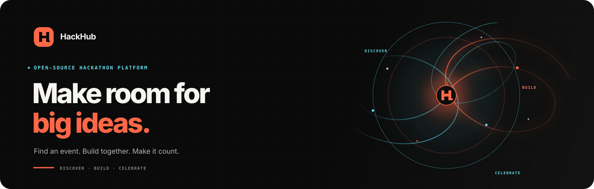

<div align="center">
  

  <p><strong>Open-source hackathon management, from the first event draft to verified certificates.</strong></p>

  <p>
    <a href="https://github.com/Mohamed-Sll/hackhub-platform/actions/workflows/ci.yml"></a>
    <a href="LICENSE"></a>
    
    
  </p>

  <p>
    <a href="#features">Features</a> ·
    <a href="#get-started">Get started</a> ·
    <a href="STACK.md">Technology stack</a> ·
    <a href="docs/ARCHITECTURE.md">Architecture</a> ·
    <a href="docs/PRODUCT_PLAN.md">Product plan</a> ·
    <a href="CONTRIBUTING.md">Contributing</a>
  </p>
</div>

<p align="center"><a href="https://frontend-40uspsv0q-mohamedsillahhh-clouds-projects.vercel.app"><strong>Open the live preview</strong></a></p>

The hosted preview contains the Next.js frontend only. The FastAPI backend and
SQLite database are not hosted, so data and account workflows require running
the project locally as described below.

HackHub is a full-stack platform for running hackathons and innovation
challenges. Organizers manage events, teams, challenges, judging, and results
in one place. Participants build together, submit projects, follow rankings,
and receive certificates that can be verified publicly.

## Features

- **Event lifecycle:** draft, publish, run, and close events with role-aware
  organizer tools.
- **Low-friction registration:** visitors register for published events with
  their name and email; no participant account is required for this flow.
- **Teams and projects:** create teams, invite members, manage leadership,
  and submit one project per team.
- **Challenges and judging:** define categories and weighted criteria, collect
  judge evaluations, and calculate project rankings.
- **Live results:** stream ranking updates over Server-Sent Events (SSE);
  Redis caching is optional.
- **Certificates:** generate PDF certificates with QR codes and public
  integrity checks.
- **Dashboards and exports:** view public event metrics, role-scoped
  dashboards, and export data as CSV or XLSX.
- **Optional integrations:** email, Telegram notifications, and OpenAI-backed
  event assistance and project feedback require provider credentials.
- **Session security:** revocable sessions with HTTP-only cookies, rotating
  refresh tokens, and role-based access control.

## Technology

For a quick, copyable list of the technologies used in HackHub, see
[the full stack reference](STACK.md).

| Layer | Stack |
| --- | --- |
| Web | Next.js 16, React, TypeScript, Tailwind CSS, TanStack Query, Zustand |
| API | FastAPI, Python 3.12, Pydantic, SQLAlchemy async |
| Persistence | SQLite for the supported single-instance setup; Alembic migrations |
| Optional services | Redis cache, SMTP, Telegram Bot API, OpenAI API |
| Operations | Docker Compose, Nginx, GitHub Actions |

## Get started

### Requirements

- Python 3.12 or newer
- Node.js 20 or newer
- Docker with the Compose plugin (optional)
- Redis (optional for local development)

### Run locally

```bash
git clone https://github.com/Mohamed-Sll/hackhub-platform.git
cd hackhub-platform

cp backend/.env.example backend/.env
cp frontend/.env.example frontend/.env.local

python -m venv .venv
# Windows PowerShell: .\.venv\Scripts\Activate.ps1
# macOS/Linux:        source .venv/bin/activate
python -m pip install -r backend/requirements-dev.txt

cd backend
alembic upgrade head
python -m app.create_first_admin
uvicorn app.main:app --reload --port 8000
```

The setup command interactively creates the first verified administrator. It
refuses to run once an administrator already exists. Keep this account's
credentials private; privileged roles are not selectable during public signup.
Public registration creates participant accounts. To grant organizer access to
an existing account, run this from `backend/` using the same database
configuration as the API:

```bash
python -m app.set_organizer organizer@example.com
```

The command requires shell access to the installation, verifies that the
account exists and is active, and does not expose role changes through the
public API. The user should sign out and sign back in before opening the
organizer dashboard and creating events.

For a self-hosted installation without SMTP, an administrator with shell access
can reset an account password from `backend/` with `python -m app.reset_password`.
The command asks for the account email, confirmation, and the new password, then
revokes that account's active sessions.

In a second terminal, from the repository root:

```bash
cd frontend
npm ci
npm run dev
```

Open the web app at `http://localhost:3000` and the API documentation at
`http://localhost:8000/docs`. The backend uses the SQLite URL from
`backend/.env.example`; apply Alembic migrations before starting it.

### Run with Docker Compose

```bash
docker compose up --build
```

The web app is available at `http://localhost` through Nginx. Compose also
starts the API and Redis and stores the SQLite database in a named volume.
The default Compose configuration is for local development. For a production
deployment, set a unique `SECRET_KEY`, HTTPS `APP_URL` and `CORS_ORIGINS`,
`ENVIRONMENT=production`, and `AUTO_CREATE_TABLES=false`; configure trusted
hosts and external delivery providers for your environment. The API validates
production secret, origin, and migration settings at startup.

## Configuration

Copy the example files and change only the settings you need:

- [`backend/.env.example`](backend/.env.example) — API, database, session,
  mail, Telegram, and AI settings.
- [`frontend/.env.example`](frontend/.env.example) — public API base URL.

Keep real credentials out of source control. Optional integrations are
unavailable until their provider credentials are configured. For the complete
operational boundaries and module overview, see
[Architecture](docs/ARCHITECTURE.md).

## Project layout

```text
backend/       FastAPI application, domain services, API, migrations, tests
frontend/      Next.js application, routes, components, hooks, and state
STACK.md       Quick reference for the project's technology stack
docs/          Architecture and technical project notes
scripts/       Local setup and SQLite backup utilities
MEMORIA/       Maintainer reference for domain rules and decisions
```

## Project status

HackHub is an open-source project with a working single-instance deployment
baseline. SQLite is the supported database configuration today. High
availability, horizontal scaling, billing, custom domains, background job
workers, and public-key PDF signatures are outside the current implementation.
Email, Telegram, and OpenAI integrations need real provider credentials and
staging validation before production use.

Public event registrations collect a name and email and are visible only to
the event owner and administrators. Organizers can remove registrations from
the dashboard. Email confirmation is not sent by this flow. The first
administrator for a self-hosted installation is created with
`python -m app.create_first_admin` from `backend/` after applying migrations.
For the product direction and staged scope, see the [product plan](docs/PRODUCT_PLAN.md).

## Development and contributions

See [`CONTRIBUTING.md`](CONTRIBUTING.md) for local setup, code checks, and pull
request guidance. The project uses pytest, Alembic, Black, isort, Flake8,
ESLint, TypeScript checks, and Playwright browser flows. Run `npx playwright
install chromium` once from `frontend/` before `npm run test:e2e`. These browser
tests use isolated API fixtures and do not modify a developer's database. CI
runs backend checks and tests, frontend lint/type checks/build and browser
flows, dependency audit, and Docker image build.

## License

HackHub is distributed under the [MIT License](LICENSE).

---

Built by [Mohamed Sillah](https://github.com/mohamedsillahhh-cloud). Issues
and contributions are welcome.
