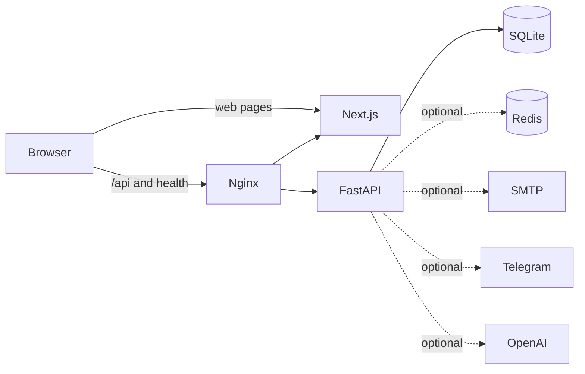

# Architecture and operating model

This document describes the code that is present in the repository today.
The implementation is the source of truth; planned capabilities are not listed
as implemented features.

## System overview

HackHub is a two-application monorepo. The Next.js web client calls a FastAPI
API. Docker Compose adds Nginx as a reverse proxy and Redis as an optional
cache/counter service. Alembic owns database schema changes.

## Backend boundaries

The API is under `backend/app/`:

| Package | Responsibility |
| --- | --- |
| `api/v1/endpoints/` | HTTP routes, request dependencies, and response contracts |
| `schemas/` | Pydantic request and response models |
| `services/` | Domain rules and operations across records |
| `repositories/` | Reusable SQLAlchemy data access |
| `models/` | ORM entities, relationships, and constraints |
| `core/` | Settings, database lifecycle, authentication, and shared dependencies |
| `utils/` | Email and helper integrations |

`get_db` provides an async SQLAlchemy session for each request and commits
successful requests, rolling back when an exception occurs. Services flush
changes inside that transaction; they do not own request-level commits.

## Authentication and access

Access and refresh JWTs are stored in HTTP-only cookies. Refresh tokens rotate
and are associated with revocable database sessions. Password reset and email
verification use action tokens outside the login-session flow. Access checks
use the roles `admin`, `organizer`, `judge`, and `participant`; event-scoped
organizer actions are limited to that organizer's events.

The frontend sends cookies with credentialed API requests. Its Axios client
coordinates refresh when concurrent requests receive an unauthorized response.
See `MEMORIA/fluxos/autenticacao.md` for the detailed session flow.

## Event lifecycle and data flow

An administrator or organizer creates an event and configures its challenges
and weighted criteria. Published events accept an accountless registration
with a name and email; only the event owner and administrators can view or
remove registration records. Existing participant accounts can also form or
join an event team, submit one project as the team, and judges or administrators
evaluate submitted work. The ranking service derives results from evaluations;
clients can read a snapshot over HTTP or subscribe to updates over
Server-Sent Events. Certificates are generated as PDFs and carry a QR code that
links to a public integrity check.

Notifications are persisted in the application. Email and Telegram delivery
are optional integrations. AI assistance, project feedback, and team
suggestions depend on configuration and have the limits described in
`MEMORIA/ESTADO.md`.

## Frontend boundaries

The web app is under `frontend/src/`:

| Path | Responsibility |
| --- | --- |
| `app/` | Next.js App Router pages, loading states, and error boundaries |
| `components/ui/` | Shared interface primitives |
| `components/forms/`, `components/shared/` | Domain forms and views |
| `hooks/` | TanStack Query server-state operations |
| `lib/api.ts` | Axios client and session refresh coordination |
| `store/` | Local authentication and theme state |
| `types/` | Shared TypeScript API contracts |

## Persistence and migrations

SQLite is the supported database for the current single-instance installation.
SQLite foreign keys and WAL mode are enabled by the backend. Alembic migrations
are required for persistent schema changes and run at backend container start.
The container entrypoint can recognize the documented legacy SQLite baseline
before applying current migrations; it does not replace migrations for future
changes.

Redis is optional. Without it, ranking reads work without the cache and AI
daily-usage counters are unavailable. SQLite and the current deployment path
are not presented as a horizontally scaled database architecture.

## Runtime endpoints

| Endpoint | Purpose |
| --- | --- |
| `/` | API name and version |
| `/docs` | Interactive OpenAPI documentation in development |
| `/health/live` | Process liveness |
| `/health/ready` | Database readiness |
| `/api/v1/*` | Versioned application API |

In the Docker setup, Nginx routes `/api/`, `/docs`, `/openapi.json`, `/redoc`,
and `/health/` to the API and other paths to the frontend.

## Configuration and deployment

Development values are documented in `backend/.env.example` and
`frontend/.env.example`. Provider credentials are optional in local
development. In production, the backend rejects weak or short secrets,
non-HTTPS public origins, and automatic table creation. Set a unique
`SECRET_KEY`, HTTPS `APP_URL` and `CORS_ORIGINS`, trusted host names, and
`AUTO_CREATE_TABLES=false`; apply Alembic migrations as part of deployment.
Keep `SECRET_KEY` stable while issued HMAC-signed certificates need public
verification; rotating it invalidates those signatures.

Back up the SQLite database before deployment. `scripts/backup_sqlite.py`
uses SQLite's online backup API and checks the resulting database integrity.
Production operations still need environment-specific TLS, backup retention,
monitoring, delivery-provider credentials, and load validation.

## Deliberate implementation limits

- SQLite is supported for one application instance; high-concurrency and
  horizontal-scaling deployments require a different validated database path.
- Redis is an optional cache/counter dependency, not the primary datastore.
- Ranking updates use SSE; there is no WebSocket implementation.
- Newly issued certificates authenticate their identity and snapshot with a
  server-keyed HMAC; older certificates retain verification with the weaker
  legacy digest. PDFs do not carry a public-key digital signature; see
  [certificate compatibility notes](../MEMORIA/problemas/assinatura-certificados-legados.md).
- Push delivery, background workers, billing, custom domains, and platform
  file storage are not implemented.
- Accountless event registration stores name and email in SQLite. The current
  flow does not send a confirmation email; organizers can remove registrations.
- Provider integrations need credentials and staging verification before
  production use.

## Quality checks

The GitHub Actions workflow runs backend lint/format/import checks, dependency
audit, database migrations and tests; frontend lint, TypeScript and production
build; and a Docker image build. For exact local commands, see
[`CONTRIBUTING.md`](../CONTRIBUTING.md).
